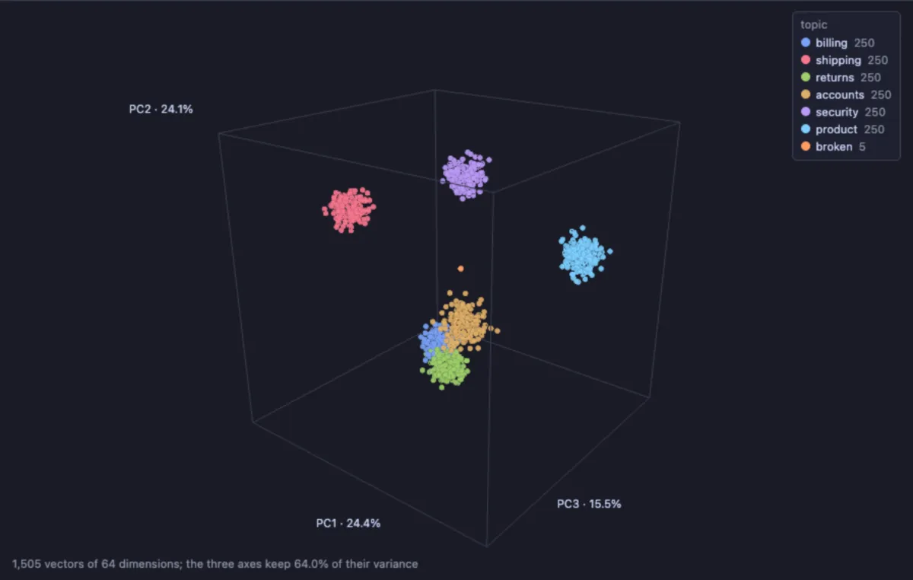
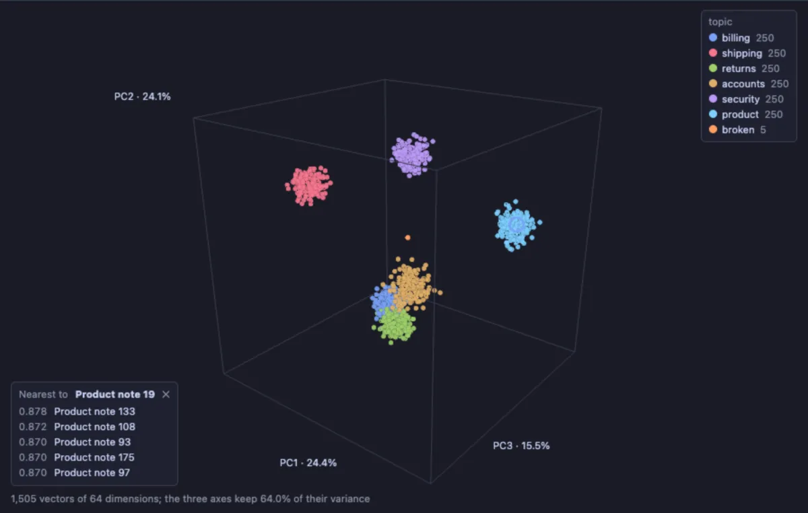

# Vector Space 3D

See what your AI embeddings look like: every row's vector placed in 3D so that rows with a similar meaning land close together, coloured by a category, and a click on a point lists its nearest neighbours.



Support notes embedded by a model, one point each, coloured by their topic. Shipping, security and product notes form clouds of their own, far apart: the model tells them apart well. Billing, accounts and returns crowd together near the middle: the model finds them alike, which is worth knowing before a search relies on telling them apart. The few orange points sitting alone are broken: their embedding is all zeros.

## What it is for

- **Checking a search or a chatbot's knowledge base**: whether the chunks of one document, or the rows of one category, stay together, and whether the model separates the categories you care about.
- **Finding bad data**: a vector far from all the others is often a parse that went wrong or a text in another language; a broken embedding (all zeros, or the same vector over and over) sits alone in one spot.
- **Exploring**: click any point and read its nearest neighbours, the rows a similarity search would return for it.

## How to read it

An embedding has hundreds or thousands of numbers; the view keeps the three directions along which your vectors differ most (principal component analysis, PCA) and places every row along them. What is near in the picture tends to be near in meaning. The axis names say how much of the differences each axis keeps, and the corner how much the three keep together: a low share means the picture flattens a lot, and only the neighbours can be trusted.

**Click** a point for its nearest neighbours by cosine similarity, computed in the full vectors rather than in the picture: lines to each, and a list in the corner with their similarity (1 is identical), where a click selects the row in the grid. Escape or ✕ clears them. **Colour by** a category gives each of the twelve most frequent values a colour (a click on the legend hides or shows them); a number colours along the theme's ramp. Hover a point for its label. Drag to turn, right drag or Shift and drag to slide, wheel to zoom, **Spin** to turn the cloud slowly.



## Try it

On your own table of embeddings:

```sql
-- @extension vector-space-3d open
-- @inputs vector=embedding, color=category, label=title
select title, category, embedding from documents limit 3000;
```

**Without a model**, six topics made up as clusters of 64-dimensional vectors, with a few zero vectors among them, on any database with pgvector; the pictures above are this table:

```sql
create extension if not exists vector;
create table vs_demo as
with topics as (
  -- 0 * t makes the subquery run once per topic, a centre each
  select t, name, array(select random() * 2 - 1 + 0 * t from generate_series(1, 64)) as c
  from unnest(array['billing', 'shipping', 'returns', 'accounts', 'security', 'product']) with ordinality as x(name, t)
)
select g as id, name as topic, initcap(name) || ' note ' || g as title,
       (select array_agg(c[d] + (random() * 2 - 1) * 0.45) from generate_series(1, 64) d)::vector(64) as embedding
from topics, generate_series(1, 250) g
union all
select 1000 + g, 'broken', 'Empty embedding ' || g, array_fill(0, array[64])::vector(64) from generate_series(1, 5) g;

-- @extension vector-space-3d open
-- @inputs vector=embedding, color=topic, label=title
select title, topic, embedding from vs_demo;
```

## Settings

| Setting | `@inputs` key | Default | What it does |
|---|---|---|---|
| Vector | `vector` | asked | The embeddings: a `vector`, `halfvec` or `sparsevec` column (pgvector), or an array of numbers |
| Colour by | `color` | none | A category (a colour each, the most frequent first) or a number (a ramp); none paints every point alike |
| Label | `label` | none | What a point is called in its tooltip and among the neighbours: a title, the start of a text |
| Neighbours | `neighbours` | 5 | How many nearest neighbours a click on a point shows |
| Top rows | `top` | 3000 | How many rows the view reads from the result; the projection takes longer the more there are |

## Good to know

The projection runs off the app's thread, so a few thousand vectors of 1536 dimensions take a moment without freezing anything. Rows with no vector, or with one of another dimension than most, are left out, and the Log says how many. The neighbours are searched among the rows the view read (Top rows), not the whole table: for the table's own nearest neighbours, the pgvector refactors write the query with the `<=>` operator. Labels are drawn over the canvas, so Copy as Image gives the points without their labels.

## Requirements

PostgreSQL 13 or newer, with the `vector` extension (pgvector) for its column types; a plain `real[]` or `float8[]` column reads too. Nothing runs on the server beyond your query: the projection runs in the result's sandbox. three.js comes from `cdn.jsdelivr.net`, which has to be an allowed remote script host (the Log offers Allow host when it is not). Three core installs with it.
